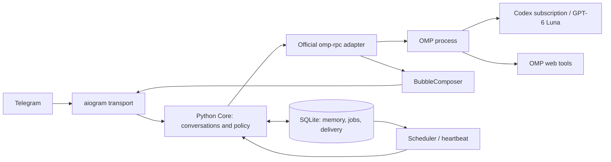

# Capri v0.1 — proposed design

Статус: **draft for joint design/plan approval; implementation prohibited**. 2026-10-24.

## Простими словами

Capri — локальний особистий агент одного власника. Telegram є його першим інтерфейсом. Python приймає повідомлення, організовує показ відповіді, пам'ять і відкладені події. OMP окремим процесом думає, викликає модель, шукає в інтернеті й виконує дозволені tools. npm лише встановлює та запускає цей комплект.

Власник підтвердив один owner та відсутність приватної пам'яті/доступу до комп'ютера у Guest Mode. Решта конкретних defaults нижче — пропозиції для перевірки, не вже погоджені рішення. [Research ledger](2026-10-24-capri-research.md) містить джерела, versions та невідомі.

## Варіанти

| Варіант | Перевага | Ціна | Рекомендація |
|---|---|---|---|
| A. Python + official RPC + готовий OMP binary + uv Python | зберігає Python 3.14; без окремого Bun; harness без змін | ~224 MB Windows OMP binary; bootstrap і compatibility checks | основний кандидат |
| B. Python + RPC + npm OMP + app-local Bun + uv | OMP як звичайна npm dependency | ще один runtime і native npm dependencies; npm alone не достатньо | fallback лише якщо binary spike не пройде |
| C. TypeScript OMP SDK + Telegram, Python sidecar | прямий SDK | суперечить Python-primary; два application runtimes або відмова від Python | не рекомендується |

Рекомендований A, остаточно підтвердити S0. Не переписувати OMP для жодного варіанта. Пишемо обидва draft documents до спільного схвалення, як вимагає user brief; це не дозвіл реалізовувати їх.

## Результат v0.1 і межі

Windows x64 — перший release target. Інші ОС — наступна packaging matrix після такого самого clean-install тесту. Node 24+ і npm уже встановлені, є мережа; OMP, Bun, Python та uv не потрібні користувачу заздалегідь. Release package name ще не вибраний/не перевірений на доступність; `<package>` у плані означає local tarball до публікації.

v0.1: owner DM, streamed drafts, semantic bubbles, interruption, OMP web, stickers/reactions, owner-only guest summon, local memory, one-shot reminders, простий heartbeat, screenshots і text/files. Voice/TTS — v0.2, з reserved capability без fake tool. Нема desktop pet, Discord, vector DB, другого agent loop, browser engine, general plugin framework, multiuser service, OS service installer чи складного multi-agent orchestrator.

Розклад реалістично 3–5 робочих днів за успішних spikes, а не гарантія. Встановлення і auth перевіряються першими; release hardening — наприкінці. Web входить до першого working slice, а не відкладається після декоративних дій.

## Ownership та процеси

- OMP володіє provider/model/auth, agent loop, tools/compaction та transcript. Не копіювати його history в SQLite як другу canonical conversation.
- Capri Core володіє destination, permissions, interruption, presentation, explicit facts, jobs, delivery metadata.
- Transport володіє Telegram Update/types, draft/final/media API, formatting, retry_after та file download. Core не імпортує aiogram.
- Один active turn на conversation. Owner DM має один persistent OMP process/session. Guest — окремий ephemeral process/session на query, максимум один guest одночасно; auth доступний harness, але credentials не tools. Не перемикати owner process у guest context.
- Heartbeat користується owner lane тільки коли той idle; звичайне повідомлення має пріоритет. Проста черга й locks, без message broker.
- Guest дозволений лише verified owner caller; unknown/anonymous caller fail closed. Reply content — дані, не інструкції. Guest отримує лише вміст поточного invocation/reply та public persona, без owner session, facts, файлів або таймерів.
- Ізолювати OMP config/home/cwd Capri; вимкнути auto-discovery сторонніх plugins, rules, MCP, skills та local execution tools. Точний підтриманий config/flags набір фіксує S4. Allowlist tools — runtime policy, не тільки system prompt. У v0.1 owner також має лише web/read-download та Capri host tools; доступ до shell/PC додається окремо пізніше.

## Вузькі контракти

Усі наведені типи — **Capri contracts**, не вигадані імена SDK.

`contracts.py` визначає immutable dataclasses:

- `SurfaceCapabilities(streaming, multiple_messages, stickers, reactions, voice, files, guest_mode: bool)`.
- `Destination(surface: Literal['telegram_dm','telegram_guest'], key: str, chat_id: int | None, thread_id: int | None, guest_query_id: str | None)`; тільки transport тлумачить Telegram IDs. key має namespace surface; guest key = query ID, не chat ID.
- `InboundEvent(event_id: str, sender_id: int, destination: Destination, text: str, reply_text: str | None, attachments: tuple[Attachment,...])`.
- `TurnRequest(turn_id: str, conversation_key: str, mode: Literal['owner','guest','heartbeat'], text: str, reply_text: str | None, attachments: tuple[Attachment,...], capabilities: SurfaceCapabilities, memory_facts: tuple[MemoryFact,...])`.
- `AgentEvent(turn_id: str, message_id: str | None, kind: Literal['text_delta','message_end','tool_status','completed','aborted','error'], text: str = '')`. Only public assistant text; reasoning та tool arguments не стають bubbles.
- `Presentation(turn_id: str, seq: int, kind: Literal['preview','commit','file','discard'], text: str = '', attachment: Attachment | None = None)`.
- `Attachment(id: str, path: str, media_type: str, name: str, size_bytes: int)`; path створений transport у Capri temp root, не довільний model-supplied path.
- `MemoryFact(key: str, value: str, updated_at: str)`.

Ports: `AgentEngine.stream(request: TurnRequest) -> AsyncIterator[AgentEvent]`, `await cancel(turn_id: str) -> None`, `await close() -> None`; `Surface.send(destination: Destination, item: Presentation) -> DeliveryReceipt`; `DeliveryReceipt(status: Literal['sent','previewed','discarded','uncertain','failed'], remote_id: str | None)`.

SDK listener переносить immutable events у event loop через `loop.call_soon_threadsafe`. Blocking SDK calls — через `asyncio.to_thread`; жодних blocking wait/RPC у reader callback. Public deltas накопичуються без втрат; bounded byte budget 256 KiB unsent text на turn, overflow abort з явною помилкою; previews coalesce, terminal events не відкидаються. Correlation: Capri turn ID → SDK prompt request ID + active message IDs. `prompt_result`, не випадковий `agent_end`, завершує model turn. User/reply text передається як JSON data в envelope з literal prefix `Capri input JSON:\n`, тому `/...` не є OMP slash command; власні Capri commands transport обробляє до model path. Якщо SDK усе ж повернув `agentInvoked=False`, adapter завершує turn явним integration error без очікування відсутнього `prompt_result`. Disable async/background harness jobs у v0.1; отриманий unsettled result вважати integration error, не оголошувати turn успішним.

## Streaming і BubbleComposer

`BubbleComposer.feed(event: AgentEvent, now_ms: int) -> list[Presentation]` є pure state machine; `tick(now_ms: int) -> list[Presentation]` обробляє lookahead без нового token event; `finish(now_ms)` flush, `ack(seq: int, receipt: DeliveryReceipt, now_ms: int) -> list[Presentation]` приймає delivery result, `cancel()` discard. Core викликає tick на deadline, не busy-poll. Нема другого model/formatter call. Тільки один outstanding commit/file; наступні deltas буферизуються до ack, без нового preview/commit. `sent` пересуває committed cursor і дозволяє наступні presentations, `uncertain`/`failed` закриває composer з explicit delivery error і без resend; preview receipts cursor не рухають. `finish` з outstanding commit записує terminal intent, а final remainder виходить після його ack.

Proposed defaults: min bubble 120 characters, preferred max 900; short answer threshold 240; lookahead 250 ms після complete boundary; draft cadence 750 ms; safe transport budget 3900 UTF-16 units. Preferred max — м'який, API limit — жорсткий. Unicode-aware sizing належить shared text helper, entity offsets — UTF-16.

1. Накопичувати append-only public text per assistant message; не зшивати reasoning/tool JSON у відповідь.
2. Розпізнавати fenced code (backticks і tildes), inline code, Markdown links, bare URLs. Boundary: blank paragraph, потім complete sentence. Не вважати period у URL завершенням речення; утримувати incomplete link/fence.
3. Поки pending text <=240, показувати draft, але не commit до завершення message. Для довшого pending text commit earliest safe boundary >=120 лише за наявності >=40 characters продовження або після lookahead, коли safe boundary перед кінцем. Якщо safe boundary немає, довший draft дозволений до hard budget.
4. При commit відправляти лише новий завершений chunk; після acknowledged `sendMessage` збільшити committed cursor. Наступний draft показує лише залишок з новим non-zero draft ID. Не надсилати whole response ще раз у final.
5. При `message_end` завершити parsing block; якщо весь turn досі <=240 characters і ще не було commit, залишити текст у draft до `completed` або зростання понад threshold. Інакше flush залишок один раз; `completed` flush held short reply і закриває turn. Tool-related assistant messages можуть давати коротку публічну репліку, але не raw tool status. Boundaries між assistant messages зберігати як paragraph separators.
6. Block/URL >soft max не ділити. Якщо >3900 units, file presentation: code як `.txt`/language filename або URL/text як `.txt`, з коротким поясненням. Це явно обрана відповідь на несумісність «ніколи не ділити block» та hard Telegram limit. Unclosed fence на кінці turn також йде файлом.
7. Drafts plain text. Final v0.1 — safe subset rendering (paragraphs, code, inline code, links, emphasis) через tested parser + aiogram entities; unsupported Markdown залишається plain text. Invalid entity rejection → plain text fallback лише коли API явно відхилив запит.
8. Guest накопичує одну відповідь і використовує `answerGuestQuery`. Capri guest deadline 20 s — власний provisional budget, не Telegram SLA; перевірити S3. Якщо результат не вміщується, один plain-text result до 3900 units з позначкою скорочення; ніяких DM/file fallback без нової авторизації.

Неможливо знати весь майбутній зміст при early commit: коротка перша bubble довгої відповіді може виглядати завершеною. Це прийнятий компроміс responsive streaming; tuning після live UX test. Буквально short whole answer <=240 завжди одна bubble.

## Interruption і доставка

New owner input: негайно increment generation epoch, discard pending preview/unsent chunks старого turn, cancel queued actions, потім SDK abort, await old completion bounded 5 s, submit новий turn. У разі timeout завершити process та відновити persistent session. Не перезапускати поточний prompt автоматично після ambiguous model/network failure. Stop update маршрутизується за active draft ID до того ж cancel path, але не створює нового prompt.

Перед кожним send/action перевіряти active epoch і capability під conversation lock. Уже committed bubbles лишаються; in-flight HTTP send не можна гарантовано відкликати. Record receipt, не видавати його за результат нового turn. Private OMP transcript може містити unsent aborted output: додати delivery note при наступному prompt із committed prefix/aborted status, не переписувати transcript.

Host-tool worker передає callback у loop через `run_coroutine_threadsafe`; cancel_event та epoch перевіряються в executor. Для SQLite mutations authorization + transaction виконуються під тим самим коротким conversation lock, що increment epoch. Mutation, committed до increment, залишається; після increment стара mutation відхиляється. Cancellation не відкочує вже створений fact/job. Для HTTP side effect lock захищає admission, але не network wait: already admitted send може завершитися після interruption і має той самий in-flight caveat. Receipts фіксують реальний результат; callback, який іще тільки чекає admission, side effect не виконує.

SQLite delivery key `(turn_id, seq)` блокує повторну локальну відправку. Telegram не надає exactly-once send для всіх API: network timeout після send позначити `uncertain`, без сліпого retry неідемпотентної операції. Явний 429 → retry_after, але тільки поки epoch актуальний; 400 → класифікувати; 401/403 → зрозуміла локальна помилка/disable route. Draft updates можуть повторюватись; final send має окремий порядок і вищий пріоритет.

## Host actions, пам'ять і jobs

`actions.py`: `await execute(name: str, args: dict, context: ActionContext) -> ActionResult`. `ActionContext(turn_id, destination, capabilities, owner_id)` створює Core; модель не може обрати довільні chat IDs. `ActionResult(ok: bool, detail: str)` повертає справжній результат, не майбутню обіцянку.

- `telegram_sticker(mood: str)`: curated alias → bundled sticker asset або bot-valid cached file ID. File IDs різних ботів не переносити. Перший upload автоматично, потім cache; невідомий mood — tool error.
- `telegram_react(reaction: str, target: Literal['incoming','reply']='incoming')`: один дозволений emoji; scope лише known incoming/reply messages. Звичайні emoji спершу; custom/paid не вимагати.
- `remember(key: str, value: str)`, `recall(query: str)`, `forget(key: str)`: owner-only explicit facts в SQLite, до 200 facts, key<=80/value<=1000 characters; ін'єкція до 8000 chars relevant/recent facts. Без automatic transcript mining/vector DB. `/memory` та `/forget` мають той самий backend.
- `schedule(text: str, due_at: str)`: один future ISO-8601 timestamp з offset, owner DM destination implicit; повертає job ID. `cancel_schedule(job_id: str)` і `list_schedules()`. Natural-language час модель уточнює коли неоднозначно; зберігати UTC + display timezone `Europe/Warsaw`.
- `telegram_voice` не реєструється до v0.2. Surface flags визначають не тільки prompt, а й registered tools і executor authorization. Guest має web only; без host side effects.

SQLite: config/owner binding, session directory registry, facts, jobs, activity, inbound IDs, action receipts, deliveries. Стандартний `sqlite3` з короткими транзакціями; filesystem OMP sessions у version-independent user data root. Міграції через schema version; backup перед migration. Secrets поза DB/logs, app-private user permissions; не копіювати особистий `.codex/auth.json` у package. OMP сам зберігає/оновлює свою Capri-local auth storage.

Scheduler: asyncio task, tick 5 s, durable single-process claim; job states pending/running/sent/failed/uncertain/cancelled, stable job ID. One-shot reminder відправляє збережений текст без LLM; missed jobs <=24 h надіслати один раз після restart з позначкою запізнення, старші — failed. Running при crash → uncertain, не повторювати автоматично.

Heartbeat: opt-in у локальному onboarding; inactivity 30 min лише від останнього owner inbound, не Telegram presence. Cooldown 2 h, quiet hours 23:00–08:00 Europe/Warsaw, max 3/day. Перевіряти gates до model call, candidate тихо discard якщо нове owner input. `mode='heartbeat'` повністю утримує assistant text/tool progress від transport і composer. Зареєстровані лише web та `proactive_decision(send: bool, text: str)`; без sticker/reaction/memory-write/schedule tools. Facts можуть читатися з підготовленого owner context. Після terminal result Core перевіряє рівно одну valid decision та повторно gates, і тільки тоді створює звичайний composer для approved text. Відсутня/invalid/multiple decision означає silence. Перед наступним owner turn відновити owner tool set після settled/aborted heartbeat; при сумніві перезапустити process. Один evaluation на inactivity window; якщо вирішив мовчати, не опитувати модель кожні 5 s. Timer delivery і heartbeat дозволені тільки коли Capri працює; сон/вимкнений ПК не забезпечують realtime.

## Media та onboarding

Owner photos: `getFile` → app temp directory → supported RPC image content, не секретний download URL у prompt. Text files за MIME/size, <=10 MiB Capri cap, original filename sanitization, не виконувати. Binary input/output у дозволених форматах передавати файлами; unsupported analysis пояснювати. TTL temp 24 h; active attachments не видаляти. Image capability проходить S5. Voice/TTS потребує окремого provider/витрат і зараз відкладений.

`npm install -g <package>` встановлює launcher. Noninteractive postinstall намагається підготувати runtime; той самий idempotent ensure виконується при першому `capri` (працює й коли install scripts вимкнені). Onboarding: Codex login, bot token, secure owner pairing через одноразовий `/start <nonce>` з локального terminal, explicit heartbeat opt-in. Не захоплювати першого довільного sender як owner. Guest Mode — окремий BotFather toggle; показати інструкцію й перевірити `getMe.supports_guest_queries`. Це додаткова дія, якої вимога «тільки два секрети» не усуває.

Node launcher використовує перевірені per-platform uv та OMP artifacts, exact Python 3.14 patch і wheels у release manifest; versions ув'язує S0. Runtime у user cache з lock/staging/atomic publish; npm directory read-only. SDK wheel збирається CI із release-matched upstream commit і включається у package, без Git/compiler на end-user PC. Усі dependencies pinned, без `latest` при запуску. Diagnostics `capri doctor` показує версії й capability results, secrets редагуються. Публікація npm/автостарт/оновлення системних налаштувань не входять у поточну роботу.

## Acceptance і unknowns

Виконання починається тільки після схвалення цього дизайну й плану. S0–S5 із research ledger мають status not run. Особливо не підтверджені Luna entitlement, subscription-backed web на конкретному account, effective OMP tool isolation, clean Python 3.14 wheels, Guest deadline та draft lifecycle у живому клієнті. Якщо S0/S1/S4 не проходять, зупинити залежні workstreams і повернути concrete findings, не міняти модель чи security boundary мовчки.

Release потрібні: clean install без preexisting runtimes; OAuth; перша live Telegram відповідь; progressive draft; early semantic commit до завершення model turn; interruption без queued stale output; grounded search; реальні sticker/reaction; guest reply без owner memory; restart facts/session/job; image recognition; logs без secrets. Mocks не підміняють live evidence. Детальні тести та file ownership — у [implementation plan](../plans/2026-10-24-capri-v01.md).
